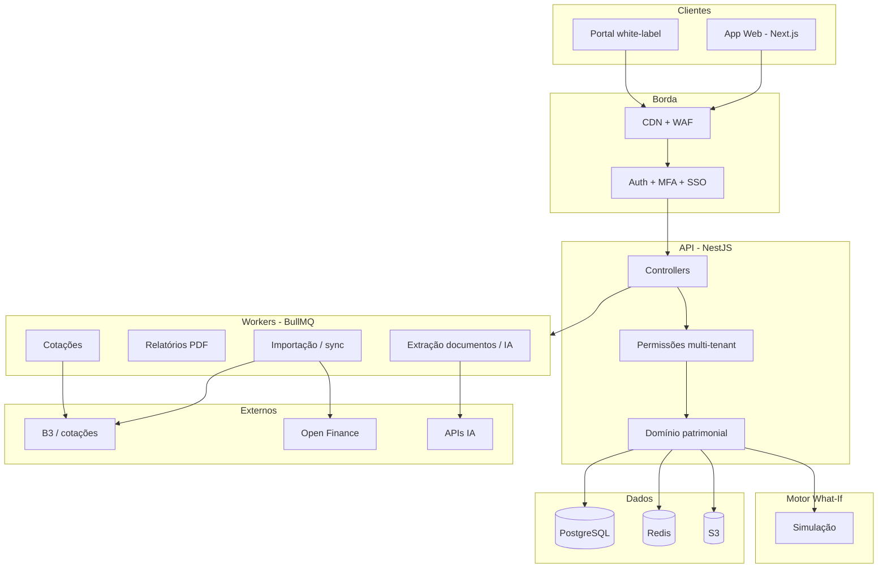

# 06 — Stack e Arquitetura

## Stack recomendada

### Frontend

| Camada | Tecnologia | Motivo |
|--------|------------|--------|
| App | **Next.js (App Router) + TypeScript** | SSR/SSO, rotas claras, SaaS B2B |
| UI | **React + Tailwind + shadcn/ui** | Rápido, consistente |
| Gráficos | **Recharts ou Visx** | Dashboards e what-if |
| Tabelas | **TanStack Table** | Portfólio, filtros, export |
| Estado servidor | **TanStack Query** | Cache, sync, multi-tenant |
| Forms | **React Hook Form + Zod** | Cadastro, premissas what-if |
| Realtime | **WebSocket / SSE** | Cotações FIIs, alertas |

### Backend

| Camada | Tecnologia | Motivo |
|--------|------------|--------|
| API | **NestJS + TypeScript** | Modular, auth, multi-tenant |
| Auth | **Auth.js / Clerk / Cognito + MFA** | SSO, convites, roles |
| Jobs | **BullMQ + Redis** | Importações, relatórios, sync |
| Motor what-if | **Serviço dedicado (Node ou Python)** | CPU-intensivo, isolado |
| Realtime | **Redis Pub/Sub + WebSocket gateway** | Cotações e notificações |

### Dados

| Camada | Tecnologia | Motivo |
|--------|------------|--------|
| DB principal | **PostgreSQL** | Relacional, multi-entidade, auditável |
| ORM | **Prisma ou Drizzle** | Type-safe, migrations |
| Cache | **Redis** | Sessões, filas, cotações |
| Search | **PostgreSQL FTS → Meilisearch** | Busca em documentos (fase 2) |
| Arquivos | **S3 (AWS) ou R2** | Contratos, PDFs, data room |
| Analytics | **ClickHouse ou Timescale** *(fase 2)* | Séries históricas |

### IA / Documentos

| Uso | Tecnologia |
|-----|------------|
| Extração PDF | Claude / GPT API + pipeline próprio |
| Parsing estruturado | Schema Zod/JSON por tipo |
| OCR | AWS Textract ou Google Document AI |

### Relatórios

| Uso | Tecnologia |
|-----|------------|
| PDF | React-PDF ou Puppeteer |
| Excel | ExcelJS |
| Filas | BullMQ |

### Infra

| Camada | Tecnologia |
|--------|------------|
| Cloud | **AWS** (ou GCP) |
| Deploy | ECS/Fargate ou Railway/Render no início |
| CI/CD | GitHub Actions |
| Secrets | AWS Secrets Manager / Doppler |
| Observabilidade | OpenTelemetry + Datadog ou Grafana |
| Erros | Sentry |

### Stack resumida

```
Next.js + TypeScript
NestJS + PostgreSQL + Redis
S3 + BullMQ
Auth com MFA
AWS
pnpm workspaces + Turborepo (monorepo)
```

---

## O que evitar no core

| Evitar | Motivo |
|--------|--------|
| Firebase como DB principal | Fraco para patrimônio multi-entidade |
| Mongo como fonte da verdade | Modelo patrimonial é relacional |
| Microserviços no dia 1 | Complexidade cedo demais |
| Emitir tokens na própria stack | Risco regulatório |

---

## Arquitetura — visão geral



---

## Papel de cada peça

| Peça | Papel |
|------|-------|
| **Next.js** | Telas, sessão, UX. Não executa regras pesadas |
| **NestJS** | Cérebro: ativos, entidades, permissões, orquestra what-if |
| **PostgreSQL** | Fonte da verdade: patrimônio, cenários, audit log |
| **Redis** | Cache, filas, pub/sub de alertas |
| **S3** | PDFs, contratos, data room, relatórios gerados |
| **Workers** | Trabalho assíncrono: import, sync, PDF, parse |
| **Motor What-If** | Snapshot + premissas → impacto patrimonial |

---

## Fluxos principais

### Dashboard

```
1. Next autentica (MFA/SSO)
2. Nest valida tenant + permissões
3. Lê patrimônio no Postgres
4. Junta cotações do Redis (FIIs)
5. Devolve KPIs consolidados
```

### Cadastro / importação de ativo

```
1. Upload CSV/PDF → S3
2. Job na fila: parse / IA extrai campos
3. Nest cria/atualiza ativo no Postgres
4. Audit log registra ação
5. Dashboard e alertas atualizam
```

### What-If

```
1. Nest monta snapshot versionado do portfólio
2. Envia snapshot + premissas ao motor
3. Motor calcula cenários (base / stress / otimista)
4. Resultado salvo no Postgres
5. Usuário compara e exporta relatório
```

### Relatório

```
1. Usuário pede PDF
2. Job gera arquivo (template + dados rastreados)
3. Salva no S3
4. Notifica quando pronto
```

---

## Multi-tenant

```
Tenant
 └── Entidades (holding, SPE, pessoa)
      └── Ativos
      └── Documentos
      └── Cenários
 └── Usuários + roles
 └── Audit log
```

**Regras:**

- Todo registro tem `tenant_id`
- Permissão checada antes de ler/escrever
- Colaborador externo só vê escopo liberado
- Row-level security no Postgres

---

## Dois tipos de "tempo real"

| Tipo | Exemplo | Como |
|------|---------|------|
| **Mercado** | Preço FII | Worker → Redis → WebSocket/SSE |
| **Evento** | Capital call, vencimento | Evento no domínio → inbox de alertas |

Imóvel físico e PE **não** fingem tempo real.

---

## Domínio patrimonial (IP)

```
Ativo
 ├─ tipo (imóvel, FII, CRI, PE…)
 ├─ valuation (método + data + fonte)
 ├─ fluxos (aluguel, provento, juros, capital call)
 ├─ liquidez (prazo estimado de saída)
 └─ documentos / eventos

Portfólio
 ├─ agregação por entidade / classe / região
 ├─ métricas (yield, concentração, liquidez estrutural)
 └─ snapshot para what-if e relatórios
```

---

## Monorepo

**Sim — monorepo desde o dia 1.**

### Estrutura

```
altora/
├── apps/
│   ├── web/          # Next.js
│   ├── api/          # NestJS
│   ├── worker/       # BullMQ jobs
│   └── what-if/      # motor de simulação
├── packages/
│   ├── domain/       # tipos + regras de domínio
│   ├── db/           # Prisma/Drizzle schema
│   ├── ui/           # componentes compartilhados
│   └── config/       # eslint, tsconfig
└── tooling/
    └── ci/
```

### Por quê

| Motivo | Benefício |
|--------|-----------|
| Tipos compartilhados | `Asset`, `Scenario`, `Tenant` iguais em front e back |
| Contratos estáveis | Zod/OpenAPI compartilhados |
| Deploy coordenado | Mudou regra de portfólio? Front e API sobem juntos |
| Domínio único | Patrimônio não é produto separado |

### Quando extrair do monorepo

- Time grande com equipes independentes
- Serviço com ciclo de release muito diferente
- Só quando doer — não no dia 1

**Ferramenta:** pnpm workspaces + Turborepo

---

## Segurança

| Item | Abordagem |
|------|-----------|
| Isolamento | Row-level security + `tenant_id` |
| Criptografia | TLS + encryption at rest (KMS) |
| Campos sensíveis | Encrypt columns (CPF, docs) |
| Audit log | Tabela append-only |
| Backup | PITR PostgreSQL + cópia S3 |
| Auth | MFA obrigatório para roles sensíveis |
| LGPD | Consentimento, portabilidade, exclusão |

---

## Integrações (faseadas)

| Integração | Quando |
|------------|--------|
| CSV/Excel + upload PDF | Dia 1 |
| B3 / cotações FIIs | Cedo |
| Open Finance (Pluggy, Belvo) | Após tração |
| Tokenizadoras (API) | Fase late |

---

## Ambiente de execução

```
Internet
   ↓
CDN / WAF
   ↓
Next.js (UI)
   ↓
NestJS (API)
   ├── PostgreSQL
   ├── Redis
   ├── S3
   ├── Workers
   └── Motor What-If
```

No início: poucos serviços. Separação **lógica** desde o dia 1; separação **física** quando volume exigir.

---

## Em uma frase

A Altora funciona como um **sistema operacional patrimonial**: o front é a interface, o Nest é governança e regras, o Postgres é a memória oficial, os workers fazem o pesado, e o what-if é o simulador de decisões — sem virar corretora nem tokenizadora.
