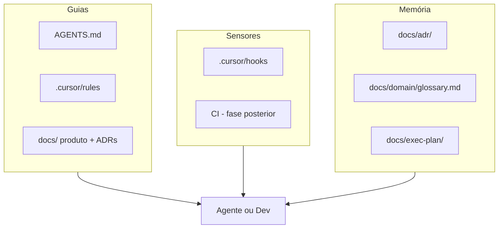

# Harness de Desenvolvimento (IA)

Sistema que orienta agentes e desenvolvedores a construir a Altora de forma consistente, segura e alinhada ao domínio patrimonial.

## O que é

O harness não é um único arquivo — é um **ambiente estruturado** com quatro camadas:



| Camada | Artefatos | Função |
|--------|-----------|--------|
| **Guias** | `AGENTS.md`, `.cursor/rules/`, docs de produto | O que fazer e como |
| **Sensores** | `.cursor/hooks/`, CI (futuro) | Feedback determinístico |
| **Memória** | ADRs, glossário, exec-plan | Decisões e termos canônicos |
| **Ambiente** | `.cursor/environment.json` | Bootstrap Cloud Agent |

## Mapa de arquivos

```
altora/
├── AGENTS.md                    # Constituição — ler primeiro
├── CLAUDE.md                    # Ponte para AGENTS.md (Claude Code)
├── .cursor/
│   ├── README.md                # Hooks e Cloud Agent
│   ├── hooks.json
│   ├── hooks/*.sh
│   ├── rules/*.mdc
│   └── environment.json         # Template Cloud Agent
├── apps/*/AGENTS.md             # Instruções por app
├── packages/*/AGENTS.md         # Instruções por pacote
└── docs/
    ├── adr/                     # Decisões arquiteturais
    ├── domain/glossary.md       # Termos canônicos
    └── exec-plan/               # Specs de features
```

## Fluxo Plan → Execute → Verify

### 1. Plan

1. Ler [`AGENTS.md`](../../AGENTS.md) na raiz
2. Verificar spec em [`docs/exec-plan/active/`](../exec-plan/active/)
3. Consultar [glossário](../domain/glossary.md) e [ADRs](../adr/) relevantes
4. Ler `AGENTS.md` do pacote onde vai trabalhar

### 2. Execute

- Implementar no pacote correto (`packages/domain` para regras, `apps/api` para HTTP, etc.)
- Respeitar regras inegociáveis: `tenant_id`, snapshot what-if, honestidade financeira
- Commits pequenos e atômicos — **agente commita, humano faz push** ([AGENTS.md](../../AGENTS.md#git--commits-e-push))

### 3. Verify

- Hooks ativos bloqueiam secrets e git destrutivo
- Ao encerrar sessão: `session-verify.sh` lembra DoD (ou roda testes quando monorepo existir)
- Definition of Done em `AGENTS.md`

## Regras inegociáveis

Resumidas de [`AGENTS.md`](../../AGENTS.md) e ADRs:

1. **Multi-tenant:** `tenant_id` em toda operação ([ADR-002](../adr/002-multi-tenant-row-level-security.md))
2. **Domínio puro:** regras em `packages/domain` ([ADR-001](../adr/001-monorepo-pnpm-turborepo.md))
3. **What-If:** snapshot → motor → persistência ([ADR-003](../adr/003-what-if-snapshot-architecture.md))
4. **Honestidade financeira:** intervalos para PE/imóvel ([04-what-if](../04-what-if.md))
5. **Audit log:** mutações patrimoniais registradas

Essas regras aparecem em três lugares complementares:

| Onde | Tipo | Para quem |
|------|------|-----------|
| `AGENTS.md` | Contrato | Toda sessão |
| `.cursor/rules/*.mdc` | Regra contextual | Arquivos abertos |
| `docs/adr/` | Decisão permanente | Arquitetura |

## Hooks

Detalhes em [`.cursor/README.md`](../../.cursor/README.md).

**Ativos agora:** bloqueio de secrets, proteção git destrutivo.

**Preparados:** lint pós-edit e verificação no `stop` — ativam quando `package.json` existir (pré-monorepo: no-op silencioso).

## Cloud Agents

Template em [`.cursor/environment.json`](../../.cursor/environment.json). Ativar após bootstrap do monorepo.

Secrets via Cursor Dashboard — nunca commitar credenciais.

## Checklist pós-bootstrap

Quando o monorepo for criado (próxima fase):

- [ ] `pnpm install && pnpm dev` funcionando
- [ ] `docker-compose.yml` com Postgres + Redis
- [ ] GitHub Actions: lint → typecheck → test → build
- [ ] Boundary tests em `tooling/ci/`
- [ ] Validar `environment.json` com Cloud Agent
- [ ] Hooks `post-edit-verify` e `session-verify` executando de verdade
- [x] Golden fixtures para motor what-if — ver [Harness de Domínio](../domain/harness/README.md)
- [ ] Ativar `pnpm test:domain` no CI — ver [ci-activation.md](../domain/harness/ci-activation.md)

## Métricas de sucesso sugeridas

| Métrica | Meta |
|---------|------|
| PRs de agente passando CI na 1ª tentativa | > 70% |
| Violações de tenant em produção | 0 |
| Sessões que verificam DoD antes de parar | > 90% |
| Specs em `exec-plan/active/` com critérios verificáveis | 100% |

## Referências externas

- [Harness de Domínio](../domain/harness/README.md) — fixtures, invariantes, contratos
- [Cursor Cloud Agent Setup](https://cursor.com/docs/cloud-agent/setup)
- [AGENTS.md spec (Next.js)](https://nextjs.org/docs/app/guides/ai-agents)
- Harness Engineering — disciplina de ambientes para agentes de código (2026)
